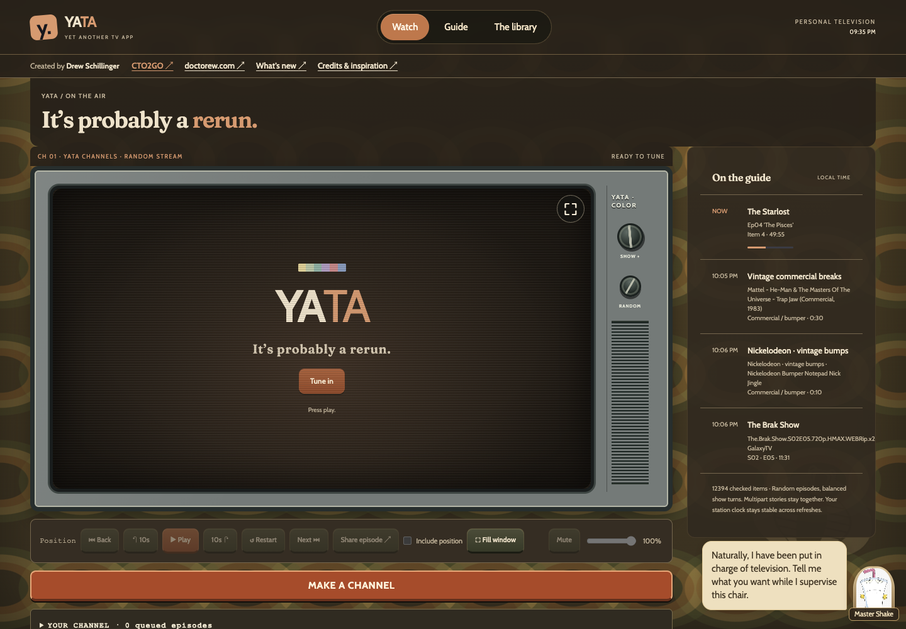
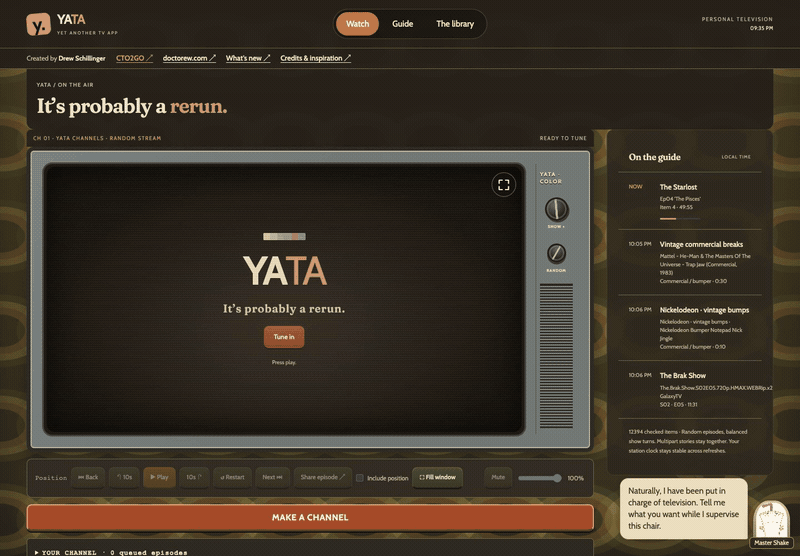
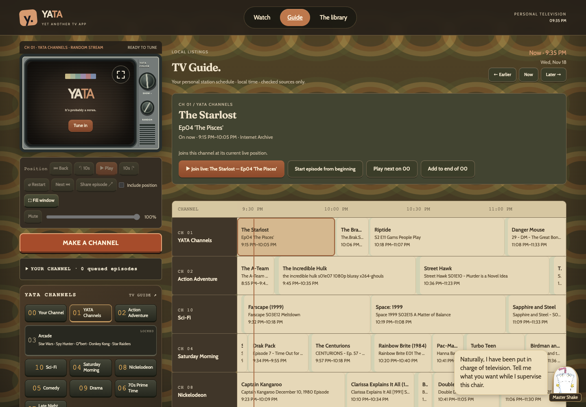
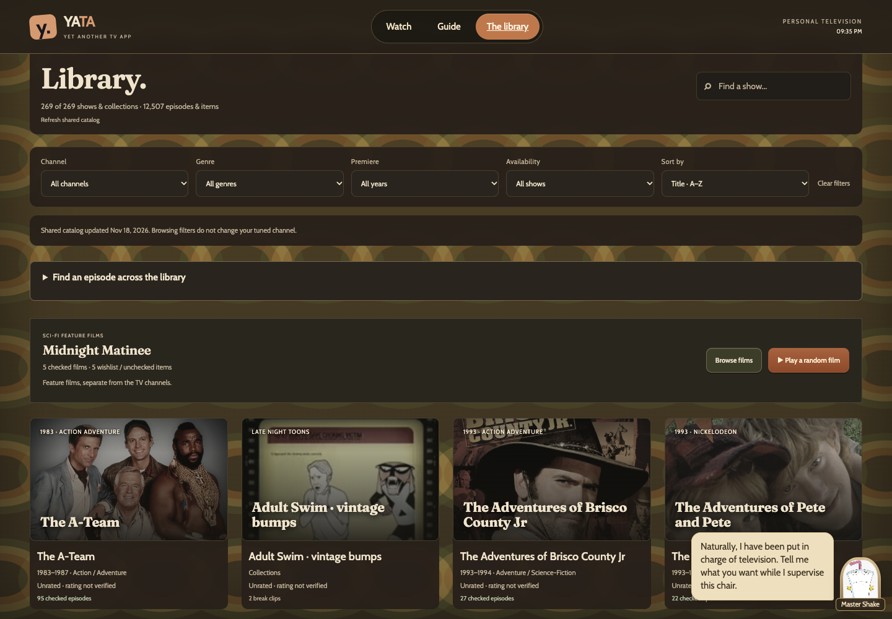

# YATA — Yet Another TV App

**It’s probably a rerun.**

A retro channel-surfing TV app built by Drew Schillinger: classic television, Saturday morning cartoons, vintage commercial breaks and character-inspired AI companions.

[Watch on the web](https://doctorew.com/tv/) · [Download Android](https://github.com/doctor-ew/yata/releases/tag/yata-android-v0.8.21) · [What’s new](CHANGELOG.md) · [Report a bug](https://github.com/doctor-ew/yata/issues/new/choose)



## See it in action

[](https://github.com/doctor-ew/yata/releases/download/yata-android-v0.8.19/YATA-web-preview.mp4)

[Watch or download the short MP4 demo](https://github.com/doctor-ew/yata/releases/download/yata-android-v0.8.19/YATA-web-preview.mp4). This silent recording shows the web interface; it is not an iOS device demonstration. Screenshots and recording were captured from the live site on November 18, 2026. Room finishes, companions and schedules vary between visits.

## Try it—and help test

| Platform | Availability |
| --- | --- |
| Web | [Open YATA](https://doctorew.com/tv/) in a modern desktop or mobile browser. |
| Android | [0.8.21 APK preview](https://github.com/doctor-ew/yata/releases/download/yata-android-v0.8.21/YATA-0.8.21-android-debug.apk). Debug-signed for sideload testing; not a Google Play release. [All releases](https://github.com/doctor-ew/yata/releases). |
| iPhone / iPad | Try the website now. A Capacitor iOS project is prepared; no compiled Apple build or TestFlight distribution has been verified in this checkout. [Apple build handoff](docs/apple/TONIGHT-HANDOFF.md). |
| Apple TV | A separate native client is planned; no tvOS app ships here. |

Testers are welcome. Especially useful feedback: playback failures, pause/resume, mobile navigation, captions, AI episode matches and accessibility. Use the TV buddy’s **Requests & bugs** flow, or [open an issue](https://github.com/doctor-ew/yata/issues/new/choose). Include the device/browser or app version, steps to reproduce, and expected behavior. Avoid private information in public issues. The buddy opens a draft for you to review and submit; it does not publish an issue automatically.

## What’s available

- **Channel surfing:** a local station clock, live-position tuning, episode starts, a TV guide and optional vintage commercial breaks.
- **Your Channel 00:** build a personal mix with the buddy, queue individual episodes, play next or append, and save the lineup on the same browser or device.
- **Mix and remix:** include or exclude genres from the main YATA mix; reshuffle one channel or the full lineup.
- **A browsable library:** original-era artwork, title search, genre/channel/year/availability filters, episode lists and season filters. Midnight Matinee keeps films separate from TV rotation.
- **TV companions:** choose or pin a character-inspired host, get recommendations, build channels and search sourced episode summaries. Companion presentation profiles refresh remotely.
- **Retro presentation:** rotating or pinned room finishes, faction decals, TV cabinets, glass/scanlines and original animated tuning snow. The saved **Static** switch controls both loading and channel-change snow; sound is configured separately.
- **Playback and sharing:** saved local resume, episode information, captions where supplied by the source, and episode or lineup links. Supported Archive playback can continue as background audio on Android; YouTube does not use that background service.
- **A hidden Arcade:** Channel 03 unlocks with the Konami sequence. Classic games appear before the optional Flash shelf. Games are hosted separately and are not bundled with the mobile app. [Arcade documentation](arcade/README.md).

### Channels

| Channel | Programming |
| --- | --- |
| 00 | Your Channel |
| 01 | YATA Channels—the main mix |
| 02 | Action Adventure |
| 03 | Arcade—locked until discovered |
| 04 | Saturday Morning |
| 05 | Comedy |
| 06 | 70s Prime Time |
| 07 | Late Night Toons |
| 08 | Nickelodeon |
| 09 | Drama |
| 10 | Sci-Fi |

The guide groups programming by its viewing feel rather than strict channel-number order. Personal station settings and clocks are local; this is not a synchronized broadcast between viewers.





## How the app, backend and data fit together

| Part | Responsibility | How updates arrive |
| --- | --- | --- |
| Shared frontend | Navigation, playback controls, rendering, finite action execution, companion search and version label | Web deployment; new APK/iOS build for packaged clients |
| Guarded backend | Verified sessions, moderation, quotas, generation and typed intent routing | Server deployment; no app rebuild for compatible contracts |
| Remote public data | Catalog, artwork, Arcade metadata, companion presentation profiles | Validated feeds with local/bundled fallback |
| Private retrieval | Sourced summaries, embeddings, cached Jev decisions and spending guard | Server-side ingestion/deployment |

Companion names, portraits and greetings are presentation data. Approved identity and character-style instructions remain backend-controlled. Feed data cannot grant tools or invent playback URLs.

Natural messages that do not match a direct command go through a bounded Jev intent classifier. It returns an allowed intent, not code, URLs or generated tool arguments. The app validates catalog identities before acting. Uncertain or unavailable classification asks for clarification; it does not guess an action. Direct known commands remain a fast path. The same existing session/usage limits apply, and classifier calls share the retrieval spending allowance and cache. The interface version appears in the header and About/footer; it identifies loaded application code, not the catalog revision.

## Episode search and AI

Ask for a show, build a mix, or describe an episode you remember. Episode-title search works across the library; plot questions in buddy chat use source-backed retrieval.

The current private retrieval corpus contains **4,192 episode summaries across 114 series**. Coverage is partial. Results include source citations and must resolve to existing catalog episodes and sources before playback. Ambiguous stories can produce several choices—for example, two Knight Rider episodes involve motorcycle gangs. Retrieval does not silently start one of them.

This is whole-episode summary search. It does not search full scripts, prove exact dialogue, identify the current scene or provide scene timestamps. Summaries may contain spoilers. Named-series searches use bounded candidate lists; broad unnamed questions have lower recall. [Coverage, exclusions and live acceptance checks](docs/buddy-retrieval/COVERAGE-EXPANSION.md).

## Catalog, providers and privacy

The published catalog, library artwork, Arcade metadata and companion roster are data-driven. Validated public feeds can refresh content without rebuilding the app; new native capabilities still require an app update. The TV catalog uses immutable snapshots and SHA-256 verification. Native clients retain a bundled snapshot for offline catalog browsing; playback needs a network connection.

The published catalog observed on November 18, 2026 contains **269 shows and collections, 12,507 catalog entries and 12,821 source records**. Those counts include collections and break material; they do not imply complete series, uninterrupted availability or verified playback of every file. [Catalog API](docs/CATALOG-API.md).

Videos play through their listed providers, including Internet Archive and the official YouTube player. Tubi sources open at the provider. YATA does not bundle TV video files. Provider ads, embed restrictions, regions, captions and availability can vary. Show art and media retain their owners’ rights; catalog inclusion does not establish redistribution rights.

Personal queues, room choices and pinned companions remain device-local. Verified buddy sessions apply usage limits; model output cannot supply arbitrary playback URLs. Anonymous aggregate analytics has an opt-out and respects DNT/GPC; it excludes chat text, email and persistent viewer identifiers. [Analytics definitions and limits](docs/ANALYTICS.md).

## Run and build

### Local owner application

Use a current Node.js installation and a modern browser. The core local server requires no package installation.

```sh
npm start
```

Open the printed loopback address, normally `http://127.0.0.1:4173`. Stop it with Ctrl+C. For another port, use `PORT=4174 npm start`.

The hosted site is a viewer. Catalog editing, discovery, import/export and publication belong to the local owner workflow. Publishing needs the operator’s configured AWS credentials; editing a browser copy cannot change the shared catalog. Discovery and optional Arcade acquisition have additional tooling and provider requirements.

### Android and iOS

```sh
cd mobile
npm ci
npm run android:build
```

Android requires JDK 21 and the configured Android SDK. For iOS, use full Xcode and an Apple signing team on a Mac. The existing shared JavaScript interface is packaged with Capacitor; a full Swift rewrite is not required for the iOS target. [Mobile setup and behavior](mobile/README.md) · [Apple handoff](docs/apple/TONIGHT-HANDOFF.md).

### Checks

```sh
npm test
npm run check
```

These are local tests and syntax checks; they do not establish provider availability or Apple device compatibility. Retrieval has a separate Python suite and deployment workflow.

## Technical documentation and roadmap

| Area | Documentation |
| --- | --- |
| Releases | [Changelog](CHANGELOG.md) |
| Public metadata | [Catalog API](docs/CATALOG-API.md) |
| Retrieval | [Architecture](docs/buddy-retrieval/ARCHITECTURE.md), [coverage](docs/buddy-retrieval/COVERAGE-EXPANSION.md), [AWS IaC](deploy/retrieval/README.md) |
| Remote companions | [Roster architecture](docs/remote-buddies/ARCHITECTURE.md) |
| Hosting | [AWS deployment](docs/4/DEPLOYMENT.md) |
| Native clients | [Mobile guide](mobile/README.md), [iOS/tvOS handoff](docs/apple/TONIGHT-HANDOFF.md) |
| Arcade | [Manual](arcade/README.md), [companion routing](docs/ARCADE-BUDDIES.md) |
| Planned work | [Roadmap](docs/ROADMAP.md), [GitHub issues](https://github.com/doctor-ew/yata/issues) |

Plex integration, synchronized watch-together, cross-device queue synchronization and friend chat remain planned work. Older numbered documents preserve historical implementation and discovery evidence; use the current coverage report and release notes for current status.

## Credits

Created by **[Drew Schillinger](https://doctorew.com/)** · [CTO2GO](https://cto2go.co) · [GitHub](https://github.com/doctor-ew).

Based on Floating Browser by Chris Hansen. Retro-TV inspiration includes Joey Cato’s MyRetroTVs and Nikolay1243’s launcher. Metadata is attributed to TVmaze under CC BY-SA; artwork, characters, video and games retain their respective rights. See [attribution](ATTRIBUTION.md) and [license](LICENSE).
